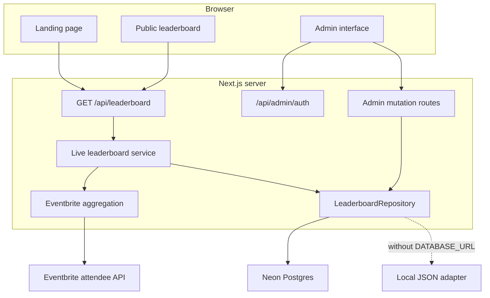

# Architecture

## Goals

KSigdillas is designed around four constraints:

1. Anyone can view the leaderboard without an account.
2. A small event team can update scores without a full identity platform.
3. Eventbrite and database secrets remain server-only.
4. The storage layer can fall back locally without changing API or UI code.

## Components

## Domain model

Each team owns five independently stored score categories:

- ticket points
- volleyball points
- eating competition points
- donation points
- bonus points

Postgres defines `total_points` as a generated column, preventing clients or
application code from persisting an inconsistent total. Check constraints keep
every category non-negative.

## Read path

1. A public client requests `GET /api/leaderboard`.
2. The service reads manual scores through `LeaderboardRepository`.
3. If Eventbrite sync is configured, a server-only request aggregates valid
   attendees by ticket type and support answer.
4. Cached Eventbrite ticket totals are overlaid on the stored teams.
5. The API returns sorted aggregate scores and a timestamp.

The browser receives no attendee-level Eventbrite data.

## Write path

1. A scorekeeper submits the configured admin passcode.
2. The server compares it using a timing-safe digest and issues an HttpOnly,
   same-site session cookie.
3. Admin routes validate team and score payloads.
4. The Postgres adapter applies score changes in one atomic `UPDATE`.
5. Database constraints reject negative category totals.

The browser never receives the configured passcode, session signing material,
database connection string, or Eventbrite token.

## Storage abstraction

`LeaderboardRepository` defines the application-facing storage contract:

- list teams
- create or edit a team
- update a score category
- replace Eventbrite ticket totals
- reset demo data

`PostgresLeaderboardRepository` is selected when `DATABASE_URL` exists.
`JsonLeaderboardRepository` remains useful for zero-configuration local
development. Routes and components do not know which adapter is active.

## Reliability choices

- Postgres score updates are atomic and safe across concurrent Vercel instances.
- The schema initializes idempotently and seeds missing default teams.
- Eventbrite is the ticket source of truth, so a fresh server can reconstruct
  ticket totals.
- Eventbrite failures degrade to the latest database-backed manual scores.
- Public requests disable HTTP caching while the external aggregate is cached
  briefly server-side to limit API traffic.

## Deliberate tradeoffs

- A shared admin passcode is simpler than OAuth for a small scorekeeping team,
  but requires disciplined rotation and limited distribution.
- Automatic schema initialization keeps deployment simple; a larger system
  should adopt versioned migrations.
- The free Neon tier fits event-scale traffic but should be monitored before a
  high-traffic public launch.
- The public board polls every 30 seconds instead of maintaining a persistent
  realtime connection.
