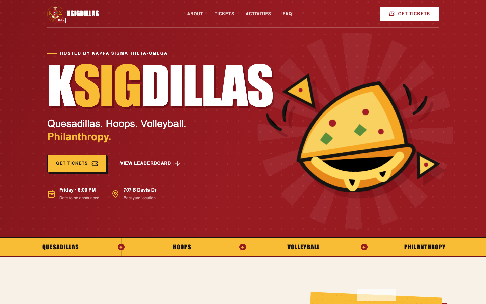
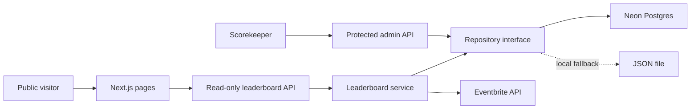

# KSigdillas

[](https://github.com/rafi-chow/KSigdillas/actions/workflows/ci.yml)
[](https://nextjs.org/)
[](https://www.typescriptlang.org/)
[](LICENSE)

KSigdillas is a full-stack event platform for Kappa Sigma Theta-Omega's
philanthropy competition. It combines a responsive event landing page,
Eventbrite ticket attribution, a public live leaderboard, and a protected
scorekeeping interface.

[Live demo](https://ksigdillas.vercel.app) ·
[Leaderboard](https://ksigdillas.vercel.app/leaderboard) ·
[Architecture](ARCHITECTURE.md) ·
[Production checklist](TODO_PRODUCTION.md)



## Project context

This repository is maintained as a public engineering case study for a real
event workflow. It is not an official Kappa Sigma International software
product or a general-purpose, community-maintained framework. Publishing the
source makes the architecture, security boundaries, and engineering tradeoffs
available for review; reuse remains subject to the license and third-party
brand terms below.

## What it demonstrates

- Server-rendered Next.js App Router pages with a responsive visual system
- A public read-only leaderboard that refreshes every 30 seconds
- Server-only Eventbrite integration with attendee answers aggregated by team
- Persistent, atomic score updates in free-tier Neon Postgres
- A repository adapter that preserves a JSON-backed local fallback
- Passcode-protected admin mutations using an HttpOnly session cookie
- Server-side validation, generated totals, and non-negative score constraints
- Secret isolation: database, Eventbrite, and admin credentials never enter the
  browser bundle
- Reproducible lint/build checks in GitHub Actions

## System overview



Eventbrite remains the source of truth for ticket attribution. Postgres stores
manual volleyball, eating, donation, and bonus scores. The public service
combines both sources and recalculates the displayed totals. See
[ARCHITECTURE.md](ARCHITECTURE.md) for request flows, boundaries, and design
tradeoffs.

## Technology

| Area | Choice |
| --- | --- |
| Framework | Next.js 16, React 19, App Router |
| Language | TypeScript with strict checking |
| Database | Neon serverless Postgres |
| External API | Eventbrite attendee API |
| Deployment | Vercel |
| Styling | Tailwind CSS entry point plus custom responsive CSS |
| Icons | Lucide React |
| Automation | GitHub Actions and Dependabot |

## Run locally

Requirements:

- Node.js 22 or newer
- npm
- Optional Eventbrite and Neon credentials for live integrations

```bash
git clone https://github.com/rafi-chow/KSigdillas.git
cd KSigdillas
npm ci
cp .env.example .env.local
npm run dev
```

Open [http://localhost:3000](http://localhost:3000). Without `DATABASE_URL`,
the app uses `.data/leaderboard.json`. Without Eventbrite credentials, manual
leaderboard scoring continues to work.

## Configuration

```env
NEXT_PUBLIC_EVENTBRITE_URL=https://www.eventbrite.com/e/your-event
NEXT_PUBLIC_INSTAGRAM_URL=https://instagram.com/your-account
NEXT_PUBLIC_CONTACT_EMAIL=contact@example.com

ADMIN_PASSCODE=use-a-long-random-passcode
DATABASE_URL=your-server-only-postgres-connection-string

EVENTBRITE_SYNC_ENABLED=true
EVENTBRITE_EVENT_ID=your-event-id
EVENTBRITE_PRIVATE_TOKEN=your-private-token
EVENTBRITE_TEAM_QUESTION=Which sorority or team are you supporting?
EVENTBRITE_SYNC_MIN_SECONDS=30
```

Only variables prefixed with `NEXT_PUBLIC_` may be sent to the browser.
`ADMIN_PASSCODE`, `DATABASE_URL`, and `EVENTBRITE_PRIVATE_TOKEN` are
server-only. Never commit `.env.local`.

## Leaderboard behavior

The public board is available at `/leaderboard`; scorekeepers use
`/admin/leaderboard`.

- Ticket points are derived from Eventbrite ticket type and support answer.
- Manual score changes are validated and written atomically to Postgres.
- Postgres generates `total_points` from the five score categories.
- Eventbrite results are cached for 30 seconds and contain no attendee PII in
  the public response.
- Refunded or cancelled attendees are excluded from ticket totals.
- The admin reset operation restores AXO, DZ, ZTA, and DDD with zero manual
  scores.

Ticket values are configured in `src/lib/scoringConfig.ts`.

## Repository layout

```text
src/app/                         Pages and server API routes
src/components/                  Public and admin UI
src/lib/eventbrite/              Server-only Eventbrite client and aggregation
src/lib/leaderboard/             Repository interface and storage adapters
src/types/                       Shared domain types
docs/images/                     Repository screenshots
.github/                         CI, dependency updates, and repository policy
```

## Quality checks

```bash
npm run lint
npm run build
npm audit --omit=dev
```

Pull requests run lint and a production build on Node.js 22. Dependency updates
are proposed weekly through Dependabot.

## Security

Public clients can only read leaderboard aggregates. Mutations require a valid
server-issued admin session. No attendee names, emails, order IDs, access
tokens, or database credentials are included in public API responses.

The passcode model is intentionally scoped to a small event team rather than a
general-purpose identity system. Rotate the passcode and Eventbrite token when
staff access changes. Report vulnerabilities through
[SECURITY.md](SECURITY.md).

## Production status

The software is deployed and uses persistent Postgres storage. Event-specific
content—including final date, beneficiary, prices, policies, and operational
approvals—remains provisional until every relevant item in
[TODO_PRODUCTION.md](TODO_PRODUCTION.md) is signed off.

## Development workflow

This is a maintainer-owned portfolio project rather than a community-governed
OSS initiative. The workflow used to develop and review changes is documented
in [DEVELOPMENT.md](DEVELOPMENT.md).

## License

Source code is available under the [MIT License](LICENSE). The Kappa Sigma
emblem is a third-party brand asset and is not relicensed under MIT; see
[THIRD_PARTY_NOTICES.md](THIRD_PARTY_NOTICES.md).
